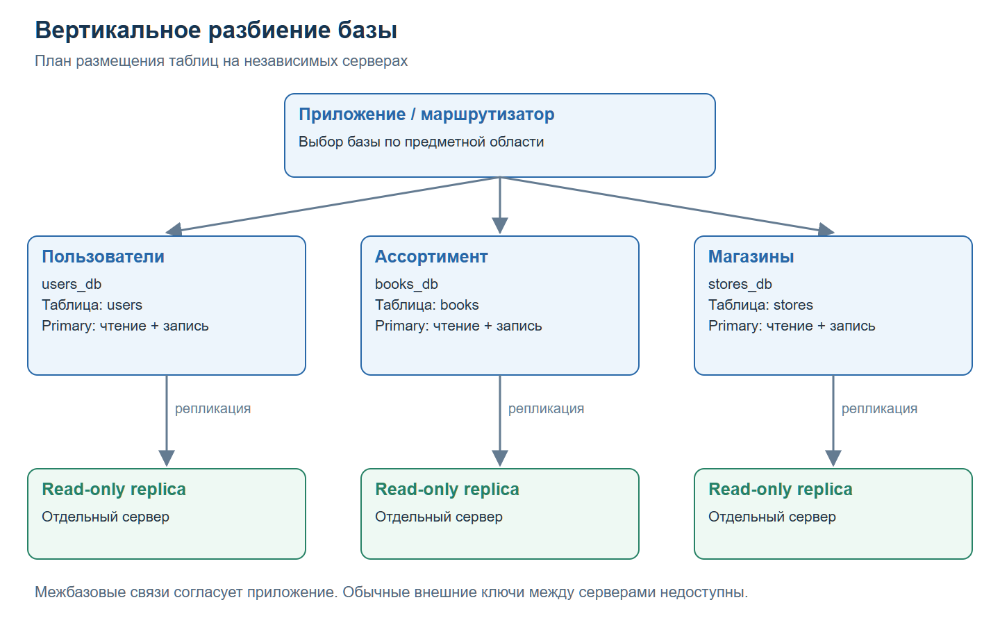
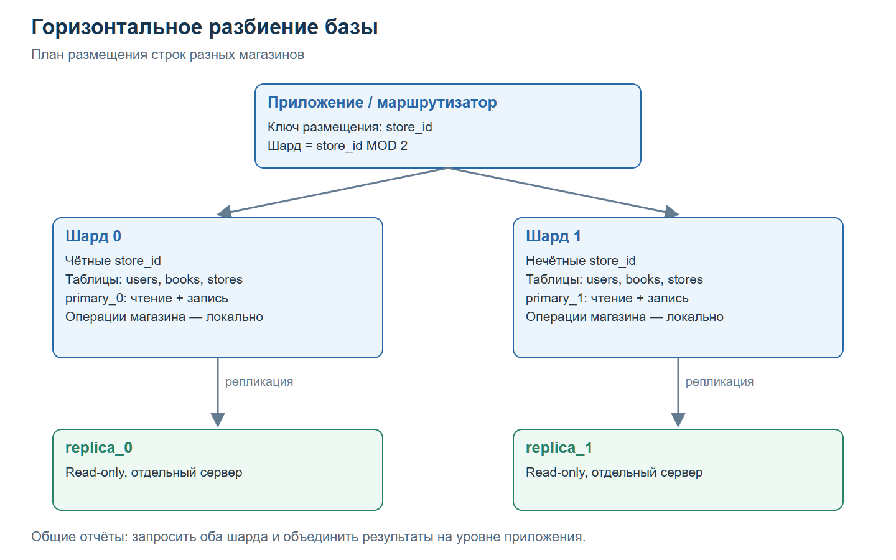

# Репликация и масштабирование. Часть 2 — Константинова Надежда

## Задание 1. Преимущества схем репликации

### Активный master и пассивный slave

Основной сервер принимает изменения и обслуживает приложение. Резервный сервер получает изменения по репликации, но до переключения не обслуживает обычные запросы приложения. Его режим — standby, запись со стороны приложения запрещена.

Преимущества:

- При отказе основного узла уже есть подготовленная копия данных: не требуется восстанавливать всю базу из резервной копии перед возобновлением обслуживания.
- Обслуживание и обновление серверов можно выполнять с плановым переключением ролей.
- Резервные копии и отдельные технические проверки можно выполнять на реплике, уменьшая нагрузку на основной сервер.
- Схема относительно проста: у каждой записи один источник изменений, конфликты между независимыми записывающими узлами не возникают.

Сама по себе репликация не выполняет безопасное автоматическое переключение. Нужны проверка отказа, выбор пригодной реплики и отключение записи на прежнем master, чтобы одновременно не появились два активных узла. При асинхронной репликации последние изменения могут ещё не попасть на резервный сервер. Репликация также не заменяет резервное копирование: ошибочное удаление данных может распространиться на реплику.

### Master и несколько slave

Изменения по-прежнему поступают на единственный master. Несколько реплик получают его изменения и могут обслуживать разрешённые запросы чтения в режиме read-only.

Преимущества:

- Чтение распределяется между репликами: можно увеличить число одновременно обслуживаемых запросов.
- Отчёты и аналитическое чтение можно отделить от оперативной нагрузки приложения.
- Можно назначить отдельную реплику для резервных копий и отдельную — кандидатом на замену master.
- Отказ одной реплики не прекращает чтение, если маршрутизатор исключает её из пула и остаются доступные узлы.

Запись таким способом не масштабируется: все изменения всё ещё обрабатывает один master. Из-за задержки репликации реплики могут возвращать устаревшие данные. Запросы, которым нужны актуальное состояние или немедленное чтение своей только что выполненной записи, направляются на master либо выполняются после проверки применения нужных изменений на реплике.

## Задание 2. План вертикального и горизонтального шардинга

В условии употреблено «шаринг»; ниже рассматривается шардинг — разбиение данных между базами. Это проектируемая схема, а не результат развёртывания дополнительного задания со звёздочкой.

Для примера принимаю следующую модель:

```text
users(store_id, user_id, full_name, email, created_at)
books(store_id, book_id, title, author, price, stock)
stores(store_id, name, city, address)
```

`store_id` у пользователя означает закреплённый магазин; запись `books` описывает книгу в ассортименте конкретного магазина. Первичные ключи: `users(store_id, user_id)`, `books(store_id, book_id)`, `stores(store_id)`. Идентификаторы и связи передаются приложением явно.

### Вертикальное разбиение

Разделение выполняется по предметным областям, целыми таблицами:

| База | Таблица | Назначение |
|---|---|---|
| `users_db` | `users` | Покупатели и их данные |
| `books_db` | `books` | Ассортимент, цены и остатки |
| `stores_db` | `stores` | Магазины и адреса |

Для каждой базы выделяется свой primary с правом записи. При необходимости к нему добавляется read-only replica на отдельном сервере. Нагрузка и ресурсы регулируются независимо: например, увеличение нагрузки на ассортимент не требует увеличивать сервер пользователей.



Приложение маршрутизирует запрос по предметной области. Связь пользователя или книги с магазином хранится как значение `store_id`, но обычный внешний ключ между независимыми серверами не работает. Проверку существования магазина и согласование межбазовых операций выполняет приложение. Для составного ответа оно получает данные из соответствующих сервисов; сложные общие отчёты можно вынести в отдельно обновляемую аналитическую систему.

Порядок внедрения:

1. Зафиксировать структуру таблиц, ключи и существующие зависимости запросов.
2. Создать три базы и отдельные учётные записи с минимальными правами для каждой области.
3. Перенести исходные данные; до переключения передавать последующие изменения контролируемым механизмом миграции.
4. Сверить количество строк, контрольные суммы и ссылки на магазины.
5. Переключить маршрутизацию на новые базы, убедиться в корректности чтения и записи; исключить запись в старую копию.
6. Настроить резервное копирование, мониторинг и проверку восстановления для каждой базы.

### Горизонтальное разбиение

Каждый шард содержит одинаковые таблицы `users`, `books`, `stores`, но строки разных магазинов. Выбирается единый ключ размещения `store_id`:

```text
shard_id = store_id MOD 2
shard_0: чётные store_id
shard_1: нечётные store_id
```

Все данные одного магазина размещаются совместно: информация о магазине, закреплённые пользователи и его ассортимент. Поэтому большинство операций внутри одного магазина выполняются на одном шарде и могут использовать локальные JOIN и транзакции.



Режимы серверов:

- `primary_0` и `primary_1` принимают запись только для своего набора магазинов.
- `replica_0` и `replica_1` работают в read-only, получают изменения своего primary и размещаются отдельно от него.
- Маршрутизатор сначала определяет шард по `store_id`, затем выбирает primary для записи или подходящий узел для чтения.
- Для глобального поиска или отчёта приложение опрашивает оба шарда и объединяет результаты; общий `LIMIT`, сортировку и агрегаты необходимо вычислять над объединённым результатом.

Порядок внедрения:

1. Проверить распределение объёма данных и нагрузки по магазинам. Два магазина разного размера могут дать неравномерную нагрузку даже при корректной формуле.
2. Подготовить одинаковую схему таблиц на обоих шардах. Локальные внешние ключи включают `store_id`, чтобы не связать строки разных магазинов.
3. Перенести строки по правилу `MOD 2`, затем синхронизировать изменения и проверить данные по каждому магазину.
4. Переключить маршрутизатор на новую схему размещения и прекратить запись в прежнюю общую базу.
5. Проверить чтение, запись, локальные связи, глобальные отчёты и восстановление каждого шарда из резервной копии.
6. Контролировать объём и задержки каждого primary и его реплики. Изменение закреплённого магазина пользователя требует явной миграции его строки на другой шард.

При дальнейшем расширении нельзя просто заменить `MOD 2` на `MOD 3`: маршрутизация изменится раньше переноса данных. Понадобится плановая миграция диапазонов или переход на виртуальные бакеты с отдельной картой размещения. На время переноса обеспечиваются согласованная передача изменений, проверка результата и однозначный момент переключения маршрутизатора.

Вертикальное разбиение разделяет предметные области, а горизонтальное — объём строк внутри одинаковой структуры. Эти подходы можно применять последовательно, но приведённые схемы показывают их отдельно.

Источники: [MySQL — репликация](https://dev.mysql.com/doc/refman/8.0/en/replication.html), [масштабирование чтения репликами](https://dev.mysql.com/doc/refman/8.0/en/replication-solutions-scaleout.html).
