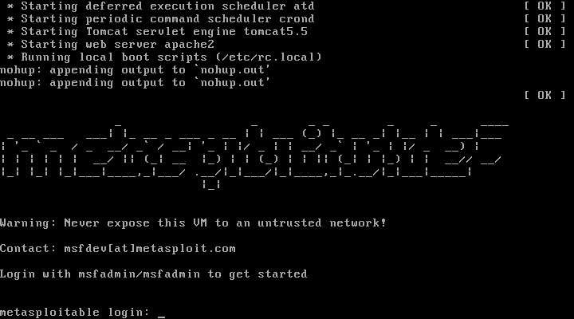
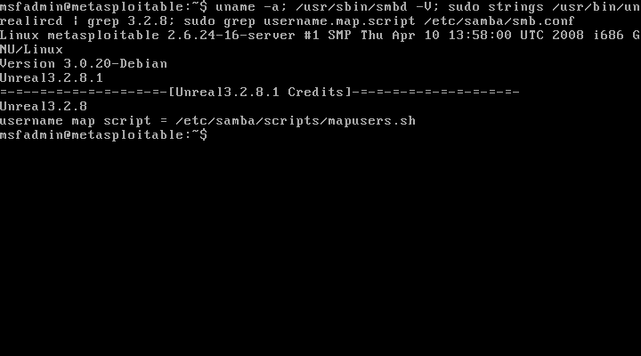

# Уязвимости и атаки на информационные системы — Константинова Надежда

## Задание 1. Сетевые службы и уязвимости Metasploitable

С официальной страницы [Metasploitable](https://sourceforge.net/projects/metasploitable/) загружена Metasploitable 2. Проверена целостность архива и запущена отдельная виртуальная машина в изолированной учебной сети. Адрес ВМ — `10.113.77.40`, адрес системы сканирования — `10.113.77.10`.



Для обнаружения служб выполнено:

```bash
nmap -sS -sV --version-light -Pn --reason --top-ports 1000 10.113.77.40
```

### Какие сетевые службы доступны

В проверенном наборе обнаружены 22 открытых TCP-порта; остальные 978 ответили как закрытые.

| Порт TCP | Служба / результат определения версии |
|---:|---|
| 21 | FTP, vsftpd 2.3.4 |
| 22 | SSH, OpenSSH 4.7p1 Debian 8ubuntu1 |
| 23 | Telnet, Linux telnetd |
| 25 | SMTP, Postfix smtpd |
| 53 | DNS, ISC BIND 9.4.2 |
| 80 | HTTP, Apache 2.2.8, Ubuntu DAV/2 |
| 111 | RPC, rpcbind |
| 139 | NetBIOS/SMB, Samba smbd |
| 445 | SMB, Samba smbd |
| 512 | rexec, netkit-rsh rexecd |
| 513 | login/rlogin |
| 514 | rsh, Netkit rshd |
| 1099 | Java RMI, GNU Classpath grmiregistry |
| 1524 | Служба, распознанная Nmap как Metasploitable root shell |
| 2049 | RPC-служба; Nmap обозначил её как rpcbind |
| 2121 | FTP, ProFTPD 1.3.1 |
| 3306 | MySQL 5.0.51a-3ubuntu5 |
| 5432 | PostgreSQL, диапазон версии по Nmap 8.3.0–8.3.7 |
| 5900 | VNC, протокол 3.3 |
| 6000 | X11, приложение отвечает access denied |
| 6667 | IRC, UnrealIRCd |
| 8180 | Порт открыт, прикладная служба в этом сканировании не распознана |

Это результат проверки 1000 стандартных портов Nmap, а не утверждение об отсутствии других открытых портов за пределами этого набора.

[Полный вывод Nmap](results/01-service-discovery.txt) · [XML сканирования](results/01-services.xml) · [Структурированный перечень служб](results/services.json)

### Три найденных сопоставления с известными уязвимостями

Версия vsftpd получена через Nmap. Для Samba Nmap показал лишь обобщённый диапазон `3.X–4.X`, поэтому точная версия дополнительно проверена на самой ВМ: `smbd -V` вернул `3.0.20-Debian`. В бинарном файле запущенной службы UnrealIRCd найдена строка `Unreal3.2.8.1`. В конфигурации Samba включён `username map script`.



| Служба | Уязвимость | Основание и возможное последствие |
|---|---|---|
| vsftpd 2.3.4 | [CVE-2011-2523, Exploit-DB 17491](https://www.exploit-db.com/exploits/17491) | Известная компрометация определённой поставки исходников версии 2.3.4: добавленный бэкдор позволяет удалённое выполнение команд. |
| Samba 3.0.20-Debian | [CVE-2007-2447, Exploit-DB 16320](https://www.exploit-db.com/exploits/16320) | Обнаруженная версия входит в затронутый диапазон; в конфигурации присутствует `username map script`. Ошибка обработки имени пользователя при этой настройке может приводить к выполнению команд. |
| UnrealIRCd 3.2.8.1 | [CVE-2010-2075, Exploit-DB 16922](https://www.exploit-db.com/exploits/16922) | Для определённых скомпрометированных архивов этой версии известен бэкдор удалённого выполнения команд. На ВМ подтверждена соответствующая версия службы. |

Сопоставление проведено по реально обнаруженным службам, версиям и указанным условиям. Для vsftpd и UnrealIRCd наличие бэкдора зависит от конкретной сборки: один номер версии сам по себе не доказывает компрометацию любого такого сервера. Эксплойты в данной работе не запускались; успешное выполнение произвольных команд через уязвимости не заявляется.

## Задание 2. SYN, FIN, Xmas и UDP

Для сравнения TCP-режимов выбраны заведомо открытые порты `21,22,80,445` и закрытый `65000`. Для UDP проверены `53,111,65000`.

```bash
nmap -sS -Pn --reason -p 21,22,80,445,65000 10.113.77.40
nmap -sF -Pn --reason -p 21,22,80,445,65000 10.113.77.40
nmap -sX -Pn --reason -p 21,22,80,445,65000 10.113.77.40
nmap -sU -Pn --reason -p 53,111,65000 10.113.77.40
```

В приложенных выводах также указаны `--max-retries 1` и ограничение времени узла `90s`. Каждому режиму соответствует отдельная запись `pcapng`, сделанная TShark — консольным инструментом Wireshark.

### Различия трафика и ответы сервера

| Режим | Отправляемые пакеты | Что получено от Metasploitable | Результат Nmap |
|---|---|---|---|
| SYN, `-sS` | TCP с флагом SYN | Четыре SYN/ACK от открытых портов и один RST от `65000/tcp` | Четыре `open`, один `closed` |
| FIN, `-sF` | TCP с FIN без ACK | Открытые порты не ответили; `65000/tcp` вернул RST | Открытые порты отображены как `open\|filtered`, закрытый — `closed` |
| Xmas, `-sX` | TCP с FIN, PSH и URG | Открытые порты не ответили; `65000/tcp` вернул RST | Четыре `open\|filtered`, один `closed` |
| UDP, `-sU` | UDP-запросы к выбранным службам | От `53/udp` и `111/udp` получены ответы UDP; от `65000/udp` — ICMP type 3, code 3 | Два `open`, один `closed` |

В FIN- и Xmas-записях по девять проб: пять исходных пакетов и повторные пробы для четырёх не ответивших портов. Отсутствие ответа не позволяет этим режимам однозначно отличить открытый порт от фильтрации, поэтому Nmap выводит `open|filtered`. Предыдущее SYN-сканирование отдельно подтвердило, что эти четыре порта открыты.

В UDP-записи обнаружены шесть отправленных UDP-пакетов и пять UDP-ответов сервера. Nmap использовал разные прикладные запросы для известных служб. Сервер отправил один ICMP Port Unreachable для закрытого порта. В той же записи есть ICMP-пакеты от сканера в обратную сторону; при подсчёте ответов сервера учитывался именно внешний IP-заголовок (`ip.src#1`), а не процитированный заголовок внутри ICMP.

TCP-флаги, IP-адреса и ICMP-коды можно проверить в приложенных таблицах пакетов и открыть сами записи в Wireshark:

| Режим | Запись трафика | Вывод Nmap | Таблица пакетов |
|---|---|---|---|
| SYN | [02-syn.pcapng](captures/02-syn.pcapng) | [SYN](results/02-syn.txt) | [TSV](results/02-syn-packets.tsv) |
| FIN | [02-fin.pcapng](captures/02-fin.pcapng) | [FIN](results/02-fin.txt) | [TSV](results/02-fin-packets.tsv) |
| Xmas | [02-xmas.pcapng](captures/02-xmas.pcapng) | [Xmas](results/02-xmas.txt) | [TSV](results/02-xmas-packets.tsv) |
| UDP | [02-udp.pcapng](captures/02-udp.pcapng) | [UDP](results/02-udp.txt) | [TSV](results/02-udp-packets.tsv) |

[Сводка автоматической проверки пакетов](results/scan-comparison.json).

Источники: [Rapid7 — Metasploitable 2](https://docs.rapid7.com/metasploit/metasploitable-2/), [режимы сканирования Nmap](https://nmap.org/book/man-port-scanning-techniques.html), [TShark и формат pcapng](https://www.wireshark.org/docs/man-pages/tshark.html).
